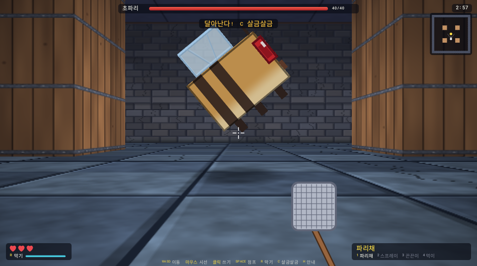
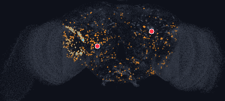
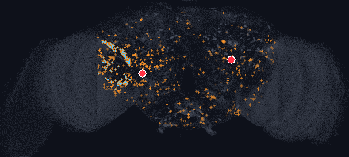
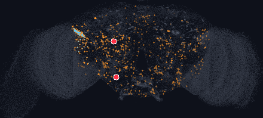
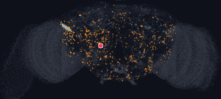
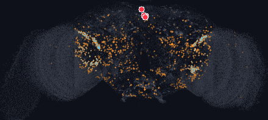
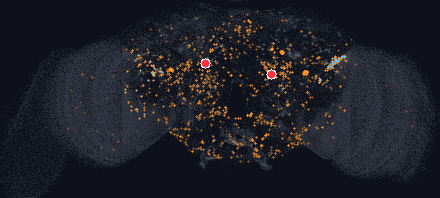
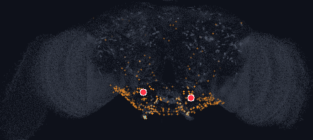

# 슈퍼 시프 파티

2026 시스템프로그래밍(ELEC462) 팀 프로젝트. 터미널에서 여럿이 접속해 하는 파티 게임이다. 참가자는 미니게임에서 **초파리 뇌 시뮬레이터가 움직이는 초파리**와 겨루고, 살아남은 사람들이 3D 화면에서 큰 초파리와 싸운다.

- 언어는 C(gnu11)이고 외부 라이브러리 없이 리눅스 시스템 호출과 pthread만 쓴다. C 코드는 검사 포함 16,000줄쯤이다.
- 초파리의 뇌는 공개된 실제 배선 자료(FlyWire v783, 뉴런 138,639개, 연결 약 1,509만 개) 위에서 논문의 식으로 발화를 계산한다. 코드는 전부 직접 썼고, 공개 자료에서는 데이터와 논문의 식만 가져왔다(출처는 아래).

| 보스전: 날아가는 초파리 | 보스전: 벽에 붙은 초파리 |
|---|---|
|  |  |

## 팀

| 이름 | 맡은 것 |
|---|---|
| 서진석 (팀장) | 서버, 클라이언트, 화면 출력, 뇌 시뮬레이터, 보스전 |
| 강연우 | 미니게임: 파리채 피하기, 거미줄 미로 |
| 김고은 | 미니게임: 음식 골라 먹기, 플래핑 플라이 |

## 빌드와 실행

Ubuntu 24.04(WSL2 포함), `gcc`, `make`가 있으면 된다.

```sh
make                      # 전부 빌드 (build/dev, 메모리 검사 켬)
make test                 # 자동 검사
make demo-local           # 한 컴퓨터에서 서버 + 봇 2명 + 나
```

여러 대로 할 때(자세한 것은 [`docs/network.md`](docs/network.md)):

```sh
make release                                  # 발표용 빌드 (build/release)
make server MODE=release BRAIN=real           # 서버 컴퓨터에서
build/release/client --host=auto --name=이름   # 같은 공유기 안이면 서버를 스스로 찾는다
build/release/client --host=서버주소 --name=이름
```

- **터미널 크기는 240칸 x 67줄 이상**이어야 한다. 전체 화면으로 하고 `Ctrl` + `-`로 글자를 줄인다.
- **진짜 뇌**(`BRAIN=real`)는 자료가 필요하다. `make brain-data`를 한 번 돌리면 공개 자료를 받아 `data/`에 준비한다(파이썬 3 필요, 수 분). 자료가 없으면 규칙으로 만든 가짜 뇌(`BRAIN=fast`)로 돈다.
- 명령의 전체 목록은 `Makefile` 맨 위에 있다.

### 터미널과 뇌 자료가 없을 때

화면을 터미널에 보내는 방법이 둘이고, 클라이언트가 시작할 때 터미널에 물어보고 고른다.

| 방법 | 언제 | 보이는 것 |
|---|---|---|
| 픽셀 그림(Sixel) | 터미널이 Sixel 그림을 받을 때. Windows Terminal은 1.22부터 받는다 | 실제 해상도의 그림. README의 화면 그림이 이것이다 |
| 글자 칸 | 그 밖의 터미널 | 글자 한 칸을 픽셀 가로 1개, 세로 2개로 쓴 그림. 게임은 똑같이 되고 그림만 거칠다 |

- 고르는 것을 직접 정하려면 `client --gfx=sixel` 또는 `--gfx=cell`을 준다.
- 터미널이 240칸 x 67줄보다 작으면 게임 대신 "지금 몇 칸인지"와 글자를 줄이라는 안내가 뜬다. 창을 키우면 바로 이어진다.
- 터미널이 화면을 제때 그리는지는 `make termbench`로 잴 수 있다.
- **뇌 자료가 없어도 게임은 된다.** `BRAIN=real`로 띄웠는데 자료가 없거나 뇌가 뜨지 못하면 서버가 알리고 가짜 뇌로 바꿔 진행한다. 진짜 뇌가 아니면 띄우지 않게 하려면 `server --brain-strict`를 준다.
- 받는 자료는 130MB쯤이고 저장소에는 들어 있지 않다(`data/`는 올리지 않는다).
- 프로그램이 죽어도 터미널은 원래대로 돌아온다. 그래도 화면이 이상하면 `reset`을 친다.

## 하는 법

| 단계 | 키 |
|---|---|
| 로비 | `스페이스` 준비, `F` 시작(방장), `B` 바로 보스전(방장) |
| 미니게임 | `W` `A` `S` `D` 이동, `스페이스` 쓰기. 게임마다 화면 아래에 안내가 나온다 |
| 보스전 | `W` `A` `S` `D` 이동, 마우스로 시선, 클릭 또는 `E` 도구 쓰기, `1`~`4` 도구 고르기(파리채, 스프레이, 끈끈이, 먹이), `R` 막기, `스페이스` 뛰기, `C` 또는 `Shift` 살금살금, `H` 안내 |
| 어디서나 | `Tab` 볼 화면 바꾸기(관전), `Q` 나가기 |

판의 흐름: 로비 → 미니게임 여러 라운드(초파리보다 점수가 낮으면 기회가 하나 줄어든다) → 보스전 → 랭킹.

## 구조

프로세스는 넷으로 나뉘고, 서로 다른 통로로 이야기한다.

```
 클라이언트 (사람마다 하나)                   서버
 ┌────────────────────────┐   TCP    ┌──────────────────────────────────────────┐
 │ 수신 스레드             │◄────────►│ 접속마다: 읽기 스레드, 쓰기 스레드          │
 │ 입력 스레드(터미널, 마우스)│          │ 접속 받기 스레드                           │
 │ 그리기, 내보내기 스레드   │   UDP    │ 시그널 스레드 (SIGCHLD, SIGALRM, SIGINT)   │
 └────────────────────────┘◄ ─ ─ ─ ─►│ 서버 찾기 스레드                           │
                             (찾기)   │ 관리 창구 스레드 ◄── 이름 있는 파이프        │
                                      │ 뇌 감시 스레드                             │
                                      │ 게임 마스터 (사건 큐 + poll 하나로 전부 진행) │
                                      └───────┬──────────────────────┬───────────┘
                                   파이프 두 개 │                      │ 공유 메모리 + 세마포어
                                (틱·입력 ↓ 화면 ↑)│                      │ (자극 ↓ 반응 ↑)
                                      ┌───────▼────────┐      ┌──────▼─────────┐
                                      │ 스테이지 프로세스 │      │ 뇌 프로세스      │
                                      │ (미니게임 하나)   │      │ (뉴런 138,639개) │
                                      └────────────────┘      └────────────────┘
```

- **게임 마스터만 게임의 상태를 바꾼다.** 다른 스레드는 일어난 일(접속, 입력, 시그널, 관리 명령)을 사건 큐에 넣고 `eventfd`로 깨우기만 한다. 그래서 게임 상태에는 잠금이 필요 없다.
- **스테이지와 뇌는 따로 도는 프로세스다.** 미니게임이 죽거나 뇌가 멈춰도 서버는 살아 있고, 그 라운드만 무효로 하거나 뇌를 다시 띄운다.
- **시그널은 한 스레드만 받는다.** 스레드를 만들기 전에 모두 막아 두고(`pthread_sigmask`) 전담 스레드가 `sigwaitinfo`로 받는다.

## 기능과 쓴 시스템 프로그래밍 요소

| 기능 | 내용 | 쓴 것 |
|---|---|---|
| 다중 접속 로비 | 3명까지 참가, 그 뒤는 관전. 접속마다 읽기·쓰기 스레드 | `socket` `bind` `listen` `accept4` `setsockopt`, pthread, mutex, 조건 변수, `poll`, `eventfd` |
| 라운드 진행 | 미니게임 하나가 프로세스 하나다. 서버가 띄우고 파이프로 틱과 입력을 주고 화면을 받는다 | `fork` `execv` `pipe` `fcntl(O_NONBLOCK)` `waitpid` `kill`, `SIGCHLD`, 주기 타이머 `setitimer`와 `SIGALRM`, 시그널 전담 스레드(`sigwaitinfo`) |
| 초파리 뇌와의 대결 | 뇌는 따로 도는 프로세스다. 자극과 반응을 공유 메모리로 주고받는다 | `shm_open` `mmap` `ftruncate`, 세마포어, seqlock(원자 연산) |
| 장애 복구 | 뇌가 멈추거나 죽으면 감시 스레드가 알아채 다시 띄우고, 계속 실패하면 가짜 뇌로 바꾼다. 스테이지가 죽으면 그 라운드만 무효로 한다 | 감시 스레드, `kill`, `waitpid`, 시간 한도가 있는 세마포어 대기 |
| 3D 보스전 | 클라이언트는 수신, 입력, 그리기 스레드와 터미널에 내보내는 스레드로 나뉜다. 벽은 광선을 쏘아 그리고 터미널에 픽셀 그림(Sixel)이나 글자 칸으로 내보낸다 | pthread, mutex, `termios` 원시 입력, `ioctl(TIOCGWINSZ)`, `SIGWINCH`, `poll` |
| 랭킹 저장 | 여러 서버가 같은 파일에 써도 깨지지 않고, 전원이 나가도 남는다 | `open(O_APPEND)` `write` `fsync` `rename` `flock` `fstat` `ftruncate` |
| 관전 | 늦게 온 사람은 관전자로 들어와 누구의 화면이든 본다 | 접속자별 보내기 큐(느린 접속자는 최신 화면만) |
| 재접속 | 게임 도중에 끊겨도 10초 안에 다시 붙으면 점수와 기회를 이어받는다 | 세션 토큰(`getrandom`), 소켓 바꿔 끼우기 |
| 서버 찾기 | 주소를 몰라도 같은 망의 서버를 찾는다 | UDP 소켓, 브로드캐스트(`SO_BROADCAST`), `sendto` `recvfrom` |
| 관리 창구 | 다른 터미널에서 `echo boss > /tmp/ssp_ctl_4620`처럼 서버를 다룬다(`status` `boss` `lobby` `quit`) | 이름 있는 파이프 `mkfifo` |
| 데몬 | `server --daemon`은 터미널에서 떨어져 뒤에서 돈다 | `fork` 두 번, `setsid`, `umask`, `dup2`, pid 파일 잠금, `syslog` |
| 자원 사용량 | 판이 끝나면 쓴 CPU 시간과 메모리를 로그에 찍는다. `--nice`로 우선순위를 낮춘다 | `getrusage` `setpriority` |
| 병렬 자가 대전 훈련 | `make boss-train`이 CPU 수만큼 프로세스를 띄워 보스전의 수치를 봇과의 대전으로 맞춘다 | `fork`, 파이프, `mmap(MAP_SHARED)`, `waitpid(WNOHANG)`, `sysconf` |
| 마우스 장치 | `client --mouse-dev=/dev/input/eventN`은 마우스의 움직임을 장치 파일에서 직접 읽는다(리눅스로 부팅한 컴퓨터) | `/dev/input`의 `struct input_event`, `ioctl(EVIOCGNAME)` |

**코드에서 찾는 곳**

| 무엇 | 파일과 함수 |
|---|---|
| 접속 받기, 접속마다의 읽기와 쓰기 | `core/server.c`의 `accept_main`, `reader_main`, `writer_main` |
| 사건 큐와 게임 마스터 | `core/server.c`의 `ev_push`, `game_master` |
| 시그널 전담 스레드, 주기 타이머 | `core/server.c`의 `signal_main`, `tick_by_timer`, `main`의 `setitimer` |
| 스테이지 프로세스 띄우기와 파이프 | `core/server.c`의 `stage_spawn`, 스테이지 쪽은 `core/stage_host.c`, `core/host_pipe.c` |
| 뇌 프로세스 띄우기, 감시, 다시 띄우기 | `core/brain_sup.c` |
| 공유 메모리와 세마포어, seqlock | `brain/brain_shm.c`, `brain/brain_shm.h` |
| 뉴런 발화 계산 | `brain/lif.c` |
| 랭킹 파일 (잠금, fsync, rename) | `core/ranking.c`의 `ranking_append`, `compact`, `open_locked` |
| 터미널 원시 입력, 창 크기 (SIGWINCH) | `ui/term.c` |
| 클라이언트의 스레드 | `core/client.c`의 `recv_main`(수신), `input_main`(입력), `run_screen`(그리기), `writer_main`(터미널에 내보내기) |
| 재접속 | `core/server.c`의 `on_join`, `away_check`, `core/client.c`의 `rejoin` |
| 서버 찾기 (UDP) | `core/server.c`의 `find_main`, `core/client.c`의 `find_server` |
| 관리 창구 (FIFO), 데몬, 자원 사용량 | `core/server.c`의 `ctl_main`, `daemonize`, `log_rusage` |
| 병렬 훈련 | `tools/bossbot.c`의 `train` |
| 마우스 장치 | `core/client.c`의 `mouse_open`, `mouse_read` |
| 보스전의 규칙, 초파리의 몸 | `boss/boss.c`, `boss/body.c` |

고장 상황은 `make test-fail`이 일부러 만들어 본다(스테이지 죽이기, 접속 끊기, 잘못된 메시지, 뇌 죽이기와 멈추기 등).

## 초파리 뇌

- **뇌:** 실제 초파리 뇌의 배선 위에서 뉴런 하나하나의 발화를 0.1ms 간격으로 계산한다. 게임은 장면을 감각 뉴런의 자극으로 바꿔 넣고(다가오는 것, 보이는 물체, 맛), 몸으로 내려가는 명령 뉴런의 발화를 읽어 초파리를 움직인다. 언제 뛰어오를지, 어느 쪽으로 걸을지, 먹을지, 날면서 어느 쪽으로 꺾을지, 언제 벽에 내려앉을지를 뇌가 정한다.
- **몸:** 뇌 자료에는 몸의 신경계가 없다. 다리 여섯의 걸음은 공개된 초파리 몸 모형 연구의 식으로 만든 생성기가 내고, 딛는 다리가 용수철로 몸을 민다.
- **한계:** 날갯짓과 공기의 힘은 계산하지 않는다. 돌진 같은 보스의 공격은 게임 규칙이다. 무엇을 잰 값으로 넣었고 무엇이 가정인지는 [`docs/brain-notes.md`](docs/brain-notes.md)에 항목마다 적었다.

## 뇌가 장식이 아니라는 근거

**배선을 섞으면 초파리가 반응하지 않는다.** 같은 시뮬레이터에 배선만 섞은 뇌를 넣어 비교했다(`make brain-compare`). 뉴런 수, 연결 수, 뉴런마다의 연결 수, 세기와 부호는 그대로 두고 "어느 뉴런으로 가는가"만 뒤섞었다.

| | 진짜 배선 | 섞은 배선 |
|---|---|---|
| 왼쪽에서 다가옴: 도약 뉴런 / 오른쪽 회전 뉴런의 발화(초당) | 195 / 15 | 0 / 0 |
| 양쪽에서 다가옴: 후진 뉴런 | 24.4 | 0 |
| 단맛: 먹기 뉴런 | 66 | 0 |
| 예제 게임에서 초파리의 점수(씨앗 10개, 120점 만점) | 101 ± 12 | 27 ± 17 |

- 섞은 뇌의 초파리는 한 번도 움직이지 않았다. 27점은 가만히 서 있을 때의 점수다.
- 말할 수 있는 것은 "반응이 뉴런 모델이 아니라 배선에서 나온다"까지다. 연결의 75%만 섞은 뇌는 여전히 99점을 냈으므로 "배선 하나하나가 정확해야 한다"고는 말할 수 없다.

**실시간으로 돈다.** 발표 구성(발표용 빌드, 진짜 뇌, 참가자 3명과 관전자 1명, 8코어 컴퓨터 한 대)에서 잰 값이다.

| 잰 것 | 값 |
|---|---|
| 뇌의 한 틱 계산(게임 시간 50ms 분량) | 평균 1.7~5.3ms, 최대 13ms. 늦거나 건너뛴 틱 0 |
| 화면이 접속자에게 도착한 수 | 미니게임 400장 중 399~400장, 보스전 600장 중 600장 |
| CPU | 뇌 2.7%, 서버 0.7%, 클라이언트 0.4% |
| 메모리 | 뇌 92MB, 나머지는 각각 2~3MB |

- 재지 못한 것: 접속자가 모두 같은 컴퓨터에 있었으므로 통신 지연은 재지 않았다.
- 실험 기록과 그 밖의 결과(맛 뉴런을 하나씩 켠 결과, 폭주 상태, 상수를 바꿔도 반응이 유지되는가)는 [`docs/brain-notes.md`](docs/brain-notes.md)에 있다.

## 프로포절에서 바뀐 점

(추후 작성. 발표에서 설명할 항목이다.)

| 프로포절의 계획 | 실제로 만든 것 | 바꾼 이유 |
|---|---|---|
| (추후 작성) | (추후 작성) | (추후 작성) |
| (추후 작성) | (추후 작성) | (추후 작성) |
| (추후 작성) | (추후 작성) | (추후 작성) |

- 계획대로 한 것: (추후 작성)
- 넣지 못한 것과 까닭: (추후 작성)

## 폴더

| 폴더 | 내용 |
|---|---|
| `core/` | 서버, 클라이언트, 스테이지를 띄우는 코드, 랭킹, 뇌 프로세스 감시 |
| `brain/` | 뇌 시뮬레이터와 뇌 프로세스, 공유 메모리 |
| `boss/` | 보스전의 계산(규칙, 초파리의 몸)과 3D 그리기 |
| `ui/` | 터미널, 입력, 글자와 그림, 화면 내보내기 |
| `stages/` | 미니게임. 폴더 하나가 게임 하나다 |
| `include/` | 미니게임이 쓰는 헤더 네 개와 통신 규격 |
| `tools/` | 뇌 자료 준비, 뇌 반응 표, 보스전 봇과 훈련 |
| `tests/` | 자동 검사 |
| `docs/` | 문서 |

## 문서

| 문서 | 내용 |
|---|---|
| [`docs/guide.md`](docs/guide.md) | 팀원 안내. 스테이지와 화면을 만드는 법, 명령, 바뀐 것 |
| [`docs/network.md`](docs/network.md) | 여러 대로 접속하는 법 |
| [`docs/brain-notes.md`](docs/brain-notes.md) | 초파리 뇌 실험 기록, 보스전 초파리의 몸과 비행의 근거 |
| [`docs/skeleton-design.md`](docs/skeleton-design.md) | 설계서 |

## 인용한 연구와 쓴 방법

**원칙.** 공개된 것에서 가져온 것은 데이터 파일과, 논문에 실린 식과 수치뿐이다. 코드는 전부 직접 썼다. 논문에 없는 값을 정해야 할 때는 가정이라고 적었고, 게임을 위해 바꾼 값은 바꿨다고 적었다(항목별 기록은 [`docs/brain-notes.md`](docs/brain-notes.md)).

### 1. 뇌의 배선 (데이터)

| 받은 파일 | 출처 | 들어 있는 것 | 어떻게 썼나 |
|---|---|---|---|
| `Connectivity_783.parquet`, `Completeness_783.csv` | [Shiu 외 2024](https://doi.org/10.1038/s41586-024-07763-9)가 공개한 [자료 파일](https://github.com/philshiu/Drosophila_brain_model). FlyWire v783 배선([Dorkenwald 외 2024](https://doi.org/10.1038/s41586-024-07558-y))에서 만든 것이다 | 뉴런 138,639개의 목록, 뉴런 쌍마다의 시냅스 수와 부호(흥분, 억제) | `tools/brain_convert.py`가 읽어서 우리 형식(`data/brain.bin`: 보내는 뉴런별로 묶은 연결 표)으로 바꾼다. 그 저장소의 코드는 쓰지 않았고 자료 파일만 받는다 |
| `annotations.tsv` | [Schlegel 외 2024](https://doi.org/10.1038/s41586-024-07686-5)의 [세포 유형 표](https://github.com/flyconnectome/flywire_annotations) | 뉴런마다의 세포 유형 이름, 좌우, 종류(감각, 하행, 운동), 위치 | 게임이 쓰는 뉴런 집단을 이름으로 고른다(`tools/brain_convert.py`의 `GROUPS`). 화면의 뇌 지도에 뉴런의 위치를 쓴다 |

자료는 `make brain-data`가 받아서 준비하며 저장소에는 넣지 않았다.

### 2. 뉴런의 발화 계산

[Shiu 외 2024, Nature 634:210](https://doi.org/10.1038/s41586-024-07763-9) "A Drosophila computational brain model reveals sensorimotor processing"

- **논문의 내용:** 뇌 전체의 배선 위에서 뉴런을 가장 단순한 모델(새는 적분 발화 뉴런)로 계산해도, 단맛 감각 뉴런을 켜면 주둥이를 내미는 운동 뉴런이 켜지는 것처럼 실제 실험과 맞는 반응이 나온다는 것을 보였다. 시냅스의 세기는 시냅스 수에 비례하고 부호는 신경 전달 물질로 정한다.
- **가져온 것:** 식과 상수. 막 시간 상수 20ms, 시냅스 시간 상수 5ms, 문턱 -45mV, 휴지 전위 -52mV, 발화 뒤 쉬는 시간 2.2ms, 전달 지연 1.8ms, 시냅스 하나의 세기 0.275mV.
- **우리가 한 것:** `brain/lif.c`에 C로 직접 구현했다. 게임의 한 틱(50ms)을 실시간으로 계산해야 해서 계산 방법은 새로 짰다.
  - 0.1ms 한 스텝을 미분방정식의 정확한 해로 진행한다(작은 걸음의 근사가 아니다).
  - 입력이 없어 가만히 있는 뉴런은 건너뛴다. 대부분의 뉴런은 대부분의 시간에 쉬고 있어서 계산량이 크게 준다.
  - 발화가 1.8ms 뒤에 전달되도록 스텝별 발화 목록을 고리 모양으로 들고 있다.
- **확인한 것:** 논문의 결과가 우리 구현에서도 나오는지 봤다. 단맛 뉴런을 켜면 먹기 운동 뉴런(MN9)이 발화하고, 쓴맛을 같이 주면 줄어든다(`make brain-table BRAIN=real`, 기록은 brain-notes 1절).
- **논문에 없는 문제와 대처:** 어떤 자극(냄새, 센 짠맛)에서는 뇌 전체가 스스로 계속 발화하는 상태에 빠진다. 그런 틱이 나오면 뇌를 처음 상태로 되돌리고, 그 자극은 게임에서 쓰지 않는다(brain-notes 2절).

### 3. 어떤 뉴런을 무엇으로 썼나

게임은 장면을 왼쪽 열의 감각 뉴런 자극으로 바꿔 넣고, 가운데 열의 뉴런이 발화하는 정도를 읽어 초파리를 움직인다.

| 행동 | 넣는 자극 (감각 뉴런) | 읽는 뉴런 | 근거로 삼은 연구 | 게임에서 |
|---|---|---|---|---|
| 뛰어올라 달아나기 | 다가오는 것을 보는 시각 뉴런 LC4, LPLC2 | 거대 섬유 뉴런 DNp01 | [von Reyn 외 2014](https://doi.org/10.1038/nn.3741): 거대 섬유는 문턱이 높고, 발화하면 하던 행동을 끊고 빠른 도약을 일으킨다 | 발화 정도가 기준을 넘으면 돌진 중이어도 뛰어오른다. 사람이 빨리 다가올수록 자극이 세고, 살금살금 다가가면 넘지 않는다 |
| 도약의 방향과 빠르기 | | | [Card와 Dickinson 2008a](https://doi.org/10.1016/j.cub.2008.07.094): 다가오는 것의 반대쪽으로 뛴다. [2008b](https://doi.org/10.1242/jeb.012682): 달아나는 도약은 초당 0.48m | 그 순간 뇌의 방향 출력을 합쳐 반대쪽으로 뛴다. 빠르기는 잰 값에 게임용 배율을 곱했다 |
| 앞으로 걷기 | 물체를 보는 시각 뉴런 LC9 | 걷기 명령 뉴런 DNp09 | [Bidaye 외 2020](https://doi.org/10.1016/j.neuron.2020.07.032): 이 뉴런을 켜면 앞으로 걸으며 켠 쪽으로 휜다 | 보이는 사람과 먹이를 자극으로 준다. LC9을 고른 것은 논문이 아니라 배선에서 직접 센 결과다(DNp09로 들어오는 연결이 가장 많은 유형) |
| 방향 전환 | | 방향 전환 명령 뉴런 DNa02 | [Rayshubskiy 외 2025](https://doi.org/10.7554/eLife.102230)(2024년 사전 공개): 좌우 DNa02의 차이가 도는 정도를 정한다 | 좌우 발화의 차이가 도는 빠르기다 |
| 뒤로 걷기 | 양쪽에서 다가옴 | 후진 명령 뉴런 MDN | [Bidaye 외 2014](https://doi.org/10.1126/science.1249964): 이 뉴런을 켜면 뒤로 걷는다 | 앞에서 다가오면 뒤로 물러나거나 뒤로 뛴다 |
| 먹기 | 단맛, 쓴맛, 물, 짠맛 감각 뉴런 | 주둥이를 내미는 운동 뉴런 MN9 | [Shiu 외 2024](https://doi.org/10.1038/s41586-024-07763-9): 단맛은 켜고 쓴맛은 끈다 | 먹이에 닿으면 단맛 자극을 주고, 발화하면 먹는다. 먹는 중에도 빨리 다가가면 도약 회로가 먼저 켜진다 |
| 날면서 피해 꺾기 | LC4, LPLC2 (위와 같은 입력) | 명령 뉴런 DNp06 | [Kim 외 2023](https://doi.org/10.1016/j.cub.2022.12.014): LPLC2와 DNp06이 비행 중 회피 회전을 일으킨다 | 떠 있는 동안 좌우 발화의 차이만큼 날아가는 방향이 돈다 |
| 내려앉기 | 시각 뉴런 LPLC4 | 착지 명령 뉴런 DNp07 | [Ache 외 2019](https://doi.org/10.1038/s41593-019-0413-4): 이 뉴런을 켜면 날던 초파리가 다리 여섯을 뻗고, 끄면 착지가 준다. 날 때만 반응한다 | 날아가는 쪽의 벽을 자극으로 주고, 발화하면 다리를 뻗고 그 벽에 붙는다. LPLC4를 고른 것은 배선에서 센 결과이고, 그 뉴런이 실제로 무엇을 보는지는 확인된 것이 없어 가정이다 |

**뇌에서 본 모습**

| | |
|---|---|
| <br>**뛰어올라 달아나기**<br>왼쪽 눈의 LC4, LPLC2에 자극. 양쪽 거대 섬유 뉴런(DNp01)을 읽는다 | <br>**날면서 피해 꺾기**<br>같은 자극. 좌우의 DNp06을 읽는다. 자극의 반대쪽이 켜진다 |
| <br>**앞으로 걷기**<br>왼쪽 눈의 LC9에 자극. 왼쪽 걷기 명령 뉴런(DNp09)을 읽는다 | <br>**방향 전환**<br>같은 자극. 왼쪽 방향 전환 뉴런(DNa02)을 읽는다 |
| <br>**뒤로 걷기**<br>양쪽 눈의 LC4, LPLC2에 자극. 후진 명령 뉴런(MDN)을 읽는다 | <br>**내려앉기**<br>양쪽 눈의 LPLC4에 자극. 착지 명령 뉴런(DNp07)을 읽는다 |
| <br>**먹기**<br>단맛 감각 뉴런에 자극. 주둥이를 내미는 운동 뉴런(MN9)을 읽는다 |  |

**그림 읽는 법.** 앞에서 본 뇌다. 회색 점은 뉴런 138,639개의 위치, 하늘색은 자극을 넣은 감각 뉴런, 주황은 그 자극을 0.5초 넣는 동안 우리 모형에서 실제로 발화한 뉴런(많이 발화할수록 밝다), 빨간 동그라미는 반응을 읽는 뉴런이다. 그림은 가져온 것이 아니라 뉴런의 위치 자료와 모형의 발화 기록으로 직접 찍었다(`make brain-figs`). 자극은 한쪽(그림의 왼쪽)에만 넣은 것이 많아서 한쪽이 밝다. 뒤로 걷기와 내려앉기는 양쪽에 넣었다.

뉴런을 고른 뒤에는 모형에서 실제로 발화하는지를 재서 확인했다(예: 한쪽에서 다가오면 반대쪽 DNp06만 초당 32~97번 발화). 자료 때문에 쓰지 못한 뉴런도 있다. 비행 중 회피의 중심이라는 DNp03은 이 자료에서 오른쪽 뉴런의 입력이 왼쪽의 5%뿐이라 발화하지 않는다.

### 4. 몸의 수치와 걸음

| 쓴 것 | 연구 | 논문의 내용 | 어떻게 썼나 |
|---|---|---|---|
| 걷는 빠르기 | [Mendes 외 2013](https://doi.org/10.7554/eLife.00231) | 자유롭게 걷는 초파리는 초당 7.2~44.7mm로 걷고 28mm가 가장 흔하다 | 걷기 명령이 1일 때 28mm, 달아날 때 44.7mm. 몸길이를 기준으로 게임의 칸으로 바꾸고, 사람이 따라갈 수 있게 전체에 배율을 곱했다 |
| 도는 빠르기 | [Geurten 외 2014](https://doi.org/10.3389/fnbeh.2014.00365) | 걷는 초파리는 짧고 빠른 회전으로 방향을 바꾼다. 한 번에 15도쯤을 0.09초쯤에 돌고, 급회전으로 보는 기준이 초당 200도다 | 방향 전환 명령이 1일 때 초당 200도 |
| 다리 여섯의 걸음 | [Wang-Chen 외 2024](https://doi.org/10.1038/s41592-024-02497-y) (NeuroMechFly v2) | 다리마다 진동자를 두고 서로 맞물려 세 다리씩 번갈아 딛는 걸음을 만든다. 뇌의 좌우 두 명령이 보폭과 방향을 정한다 | 진동자의 식, 맞물리는 세기(10), 따라가는 빠르기(20), 발을 드는 구간(앞 2.37, 가운데 2.23, 뒤 1.95 라디안)을 가져와 `boss/body.c`에 직접 구현했다. 그 모형의 코드와 물리 엔진은 쓰지 않았다 |
| 비행 중 급회전 | [Muijres 외 2015](https://doi.org/10.1242/jeb.114280) | 급회전은 몸을 옆으로 기울여 도는 회전이고, 0.05초쯤에 90도쯤 돈다 | 꺾을 때 도는 쪽으로 몸을 기울여 그린다. 도는 빠르기는 초당 1000도에 게임용 배율을 곱했다 |

**그 연구들과 다른 점**

- 걸음의 빈도는 실제(초당 12걸음)보다 낮췄다(4.5). 초당 20장인 화면에서 걸음이 보이게 하려는 것이다.
- 몸의 힘 계산은 평면 위의 몸 하나와 용수철 다리 여섯으로 줄였다. 관절, 근육, 날갯짓, 공기의 힘은 없다.
- 실제로는 비행 중 회피 뉴런과 착지 뉴런이 날 때만 반응한다. 이 뇌 모델은 날고 있는지를 모르므로, 떠 있을 때만 그 뉴런을 읽는 것은 게임 쪽이 한다.
- 돌진, 날갯짓으로 밀어내기, 가장 오래 떠 있는 시간 같은 것은 연구가 아니라 게임 규칙이다.

## 팀원 공지

**`main`을 받고(`git pull`) [`docs/guide.md`](docs/guide.md) 맨 위의 "바뀐 것"을 읽어 주세요.**

- 올리기 전에 `make test-stage STAGE=내스테이지 BRAIN=real`을 돌려 "통과"를 봅니다.
- 진짜 뇌는 가짜 뇌와 다르게 반응합니다. 음식 골라 먹기(짠맛, 물), 파리채 피하기, 플래핑 플라이는 수치를 진짜 뇌에서 다시 확인해야 합니다.
- 스테이지에서 `rand`, `time`, `sleep` 같은 함수를 쓰면 빌드가 멈춥니다. 고치는 방법은 안내에 있습니다.
- 진짜 뇌를 쓰는 컴퓨터는 받은 뒤 `make brain-groups`를 한 번 돌립니다. 서버와 클라이언트는 같은 커밋으로 다시 빌드합니다.
