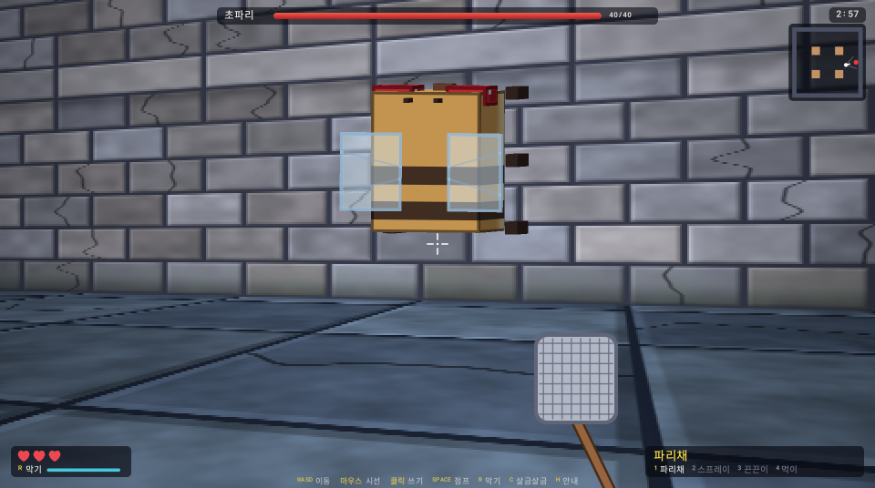

# 슈퍼 시프 파티

2026 시스템프로그래밍(ELEC462) 팀 프로젝트. 터미널에서 여럿이 접속해 하는 파티 게임이다. 참가자는 미니게임에서 **초파리 뇌 시뮬레이터가 움직이는 초파리**와 겨루고, 살아남은 사람들이 3D 화면에서 큰 초파리와 싸운다.

- 언어는 C(gnu11)이고 외부 라이브러리 없이 리눅스 시스템 호출과 pthread만 쓴다. C 코드는 검사 포함 16,000줄쯤이다.
- 초파리의 뇌는 공개된 실제 배선 자료(FlyWire v783, 뉴런 138,639개, 연결 약 1,509만 개) 위에서 논문의 식으로 발화를 계산한다. 코드는 전부 직접 썼고, 공개 자료에서는 데이터와 논문의 식만 가져왔다(출처는 아래).

| 보스전: 날아가는 초파리 | 보스전: 벽에 붙은 초파리 |
|---|---|
|  |  |

## 팀

| 이름 | 맡은 것 |
|---|---|
| 서진석 (팀장) | 서버, 클라이언트, 화면 출력, 뇌 시뮬레이터, 보스전 |
| 강연우 | 미니게임: 파리채 피하기, 거미줄 미로 |
| 김고은 | 미니게임: 음식 골라 먹기, 플래핑 플라이 |

## 빌드와 실행

Ubuntu 24.04(WSL2 포함), `gcc`, `make`가 있으면 된다.

```sh
make                      # 전부 빌드 (build/dev, 메모리 검사 켬)
make test                 # 자동 검사
make demo-local           # 한 컴퓨터에서 서버 + 봇 2명 + 나
```

여러 대로 할 때(자세한 것은 [`docs/network.md`](docs/network.md)):

```sh
make release                                  # 발표용 빌드 (build/release)
make server MODE=release BRAIN=real           # 서버 컴퓨터에서
build/release/client --host=auto --name=이름   # 같은 공유기 안이면 서버를 스스로 찾는다
build/release/client --host=서버주소 --name=이름
```

- **터미널 크기는 240칸 x 67줄 이상**이어야 한다. 전체 화면으로 하고 `Ctrl` + `-`로 글자를 줄인다.
- **진짜 뇌**(`BRAIN=real`)는 자료가 필요하다. `make brain-data`를 한 번 돌리면 공개 자료를 받아 `data/`에 준비한다(파이썬 3 필요, 수 분). 자료가 없으면 규칙으로 만든 가짜 뇌(`BRAIN=fast`)로 돈다.
- 명령의 전체 목록은 `Makefile` 맨 위에 있다.

## 하는 법

| 단계 | 키 |
|---|---|
| 로비 | `스페이스` 준비, `F` 시작(방장), `B` 바로 보스전(방장) |
| 미니게임 | `W` `A` `S` `D` 이동, `스페이스` 쓰기. 게임마다 화면 아래에 안내가 나온다 |
| 보스전 | `W` `A` `S` `D` 이동, 마우스로 시선, 클릭 또는 `E` 도구 쓰기, `1`~`4` 도구 고르기(파리채, 스프레이, 끈끈이, 먹이), `R` 막기, `스페이스` 뛰기, `C` 또는 `Shift` 살금살금, `H` 안내 |
| 어디서나 | `Tab` 볼 화면 바꾸기(관전), `Q` 나가기 |

판의 흐름: 로비 → 미니게임 여러 라운드(초파리보다 점수가 낮으면 기회가 하나 줄어든다) → 보스전 → 랭킹.

## 구조

프로세스는 넷으로 나뉘고, 서로 다른 통로로 이야기한다.

```
 클라이언트 (사람마다 하나)                   서버
 ┌────────────────────────┐   TCP    ┌──────────────────────────────────────────┐
 │ 수신 스레드             │◄────────►│ 접속마다: 읽기 스레드, 쓰기 스레드          │
 │ 입력 스레드(터미널, 마우스)│          │ 접속 받기 스레드                           │
 │ 그리기, 내보내기 스레드   │   UDP    │ 시그널 스레드 (SIGCHLD, SIGALRM, SIGINT)   │
 └────────────────────────┘◄ ─ ─ ─ ─►│ 서버 찾기 스레드                           │
                             (찾기)   │ 관리 창구 스레드 ◄── 이름 있는 파이프        │
                                      │ 뇌 감시 스레드                             │
                                      │ 게임 마스터 (사건 큐 + poll 하나로 전부 진행) │
                                      └───────┬──────────────────────┬───────────┘
                                   파이프 두 개 │                      │ 공유 메모리 + 세마포어
                                (틱·입력 ↓ 화면 ↑)│                      │ (자극 ↓ 반응 ↑)
                                      ┌───────▼────────┐      ┌──────▼─────────┐
                                      │ 스테이지 프로세스 │      │ 뇌 프로세스      │
                                      │ (미니게임 하나)   │      │ (뉴런 138,639개) │
                                      └────────────────┘      └────────────────┘
```

- **게임 마스터만 게임의 상태를 바꾼다.** 다른 스레드는 일어난 일(접속, 입력, 시그널, 관리 명령)을 사건 큐에 넣고 `eventfd`로 깨우기만 한다. 그래서 게임 상태에는 잠금이 필요 없다.
- **스테이지와 뇌는 따로 도는 프로세스다.** 미니게임이 죽거나 뇌가 멈춰도 서버는 살아 있고, 그 라운드만 무효로 하거나 뇌를 다시 띄운다.
- **시그널은 한 스레드만 받는다.** 스레드를 만들기 전에 모두 막아 두고(`pthread_sigmask`) 전담 스레드가 `sigwaitinfo`로 받는다.

## 기능과 쓴 시스템 프로그래밍 요소

| 기능 | 내용 | 쓴 것 |
|---|---|---|
| 다중 접속 로비 | 3명까지 참가, 그 뒤는 관전. 접속마다 읽기·쓰기 스레드 | `socket` `bind` `listen` `accept4` `setsockopt`, pthread, mutex, 조건 변수, `poll`, `eventfd` |
| 라운드 진행 | 미니게임 하나가 프로세스 하나다. 서버가 띄우고 파이프로 틱과 입력을 주고 화면을 받는다 | `fork` `execv` `pipe` `fcntl(O_NONBLOCK)` `waitpid` `kill`, `SIGCHLD`, 주기 타이머 `setitimer`와 `SIGALRM`, 시그널 전담 스레드(`sigwaitinfo`) |
| 초파리 뇌와의 대결 | 뇌는 따로 도는 프로세스다. 자극과 반응을 공유 메모리로 주고받는다 | `shm_open` `mmap` `ftruncate`, 세마포어, seqlock(원자 연산) |
| 장애 복구 | 뇌가 멈추거나 죽으면 감시 스레드가 알아채 다시 띄우고, 계속 실패하면 가짜 뇌로 바꾼다. 스테이지가 죽으면 그 라운드만 무효로 한다 | 감시 스레드, `kill`, `waitpid`, 시간 한도가 있는 세마포어 대기 |
| 3D 보스전 | 클라이언트는 수신, 입력, 그리기 스레드와 터미널에 내보내는 스레드로 나뉜다. 벽은 광선을 쏘아 그리고 터미널에 픽셀 그림(Sixel)이나 글자 칸으로 내보낸다 | pthread, mutex, `termios` 원시 입력, `ioctl(TIOCGWINSZ)`, `SIGWINCH`, `poll` |
| 랭킹 저장 | 여러 서버가 같은 파일에 써도 깨지지 않고, 전원이 나가도 남는다 | `open(O_APPEND)` `write` `fsync` `rename` `flock` `fstat` `ftruncate` |
| 관전 | 늦게 온 사람은 관전자로 들어와 누구의 화면이든 본다 | 접속자별 보내기 큐(느린 접속자는 최신 화면만) |
| 재접속 | 게임 도중에 끊겨도 10초 안에 다시 붙으면 점수와 기회를 이어받는다 | 세션 토큰(`getrandom`), 소켓 바꿔 끼우기 |
| 서버 찾기 | 주소를 몰라도 같은 망의 서버를 찾는다 | UDP 소켓, 브로드캐스트(`SO_BROADCAST`), `sendto` `recvfrom` |
| 관리 창구 | 다른 터미널에서 `echo boss > /tmp/ssp_ctl_4620`처럼 서버를 다룬다(`status` `boss` `lobby` `quit`) | 이름 있는 파이프 `mkfifo` |
| 데몬 | `server --daemon`은 터미널에서 떨어져 뒤에서 돈다 | `fork` 두 번, `setsid`, `umask`, `dup2`, pid 파일 잠금, `syslog` |
| 자원 사용량 | 판이 끝나면 쓴 CPU 시간과 메모리를 로그에 찍는다. `--nice`로 우선순위를 낮춘다 | `getrusage` `setpriority` |
| 병렬 자가 대전 훈련 | `make boss-train`이 CPU 수만큼 프로세스를 띄워 보스전의 수치를 봇과의 대전으로 맞춘다 | `fork`, 파이프, `mmap(MAP_SHARED)`, `waitpid(WNOHANG)`, `sysconf` |
| 마우스 장치 | `client --mouse-dev=/dev/input/eventN`은 마우스의 움직임을 장치 파일에서 직접 읽는다(리눅스로 부팅한 컴퓨터) | `/dev/input`의 `struct input_event`, `ioctl(EVIOCGNAME)` |

**코드에서 찾는 곳**

| 무엇 | 파일과 함수 |
|---|---|
| 접속 받기, 접속마다의 읽기와 쓰기 | `core/server.c`의 `accept_main`, `reader_main`, `writer_main` |
| 사건 큐와 게임 마스터 | `core/server.c`의 `ev_push`, `game_master` |
| 시그널 전담 스레드, 주기 타이머 | `core/server.c`의 `signal_main`, `tick_by_timer`, `main`의 `setitimer` |
| 스테이지 프로세스 띄우기와 파이프 | `core/server.c`의 `stage_spawn`, 스테이지 쪽은 `core/stage_host.c`, `core/host_pipe.c` |
| 뇌 프로세스 띄우기, 감시, 다시 띄우기 | `core/brain_sup.c` |
| 공유 메모리와 세마포어, seqlock | `brain/brain_shm.c`, `brain/brain_shm.h` |
| 뉴런 발화 계산 | `brain/lif.c` |
| 랭킹 파일 (잠금, fsync, rename) | `core/ranking.c`의 `ranking_append`, `compact`, `open_locked` |
| 터미널 원시 입력, 창 크기 (SIGWINCH) | `ui/term.c` |
| 클라이언트의 스레드 | `core/client.c`의 `recv_main`(수신), `input_main`(입력), `run_screen`(그리기), `writer_main`(터미널에 내보내기) |
| 재접속 | `core/server.c`의 `on_join`, `away_check`, `core/client.c`의 `rejoin` |
| 서버 찾기 (UDP) | `core/server.c`의 `find_main`, `core/client.c`의 `find_server` |
| 관리 창구 (FIFO), 데몬, 자원 사용량 | `core/server.c`의 `ctl_main`, `daemonize`, `log_rusage` |
| 병렬 훈련 | `tools/bossbot.c`의 `train` |
| 마우스 장치 | `core/client.c`의 `mouse_open`, `mouse_read` |
| 보스전의 규칙, 초파리의 몸 | `boss/boss.c`, `boss/body.c` |

고장 상황은 `make test-fail`이 일부러 만들어 본다(스테이지 죽이기, 접속 끊기, 잘못된 메시지, 뇌 죽이기와 멈추기 등).

## 초파리 뇌

- **뇌:** 실제 초파리 뇌의 배선 위에서 뉴런 하나하나의 발화를 0.1ms 간격으로 계산한다. 게임은 장면을 감각 뉴런의 자극으로 바꿔 넣고(다가오는 것, 보이는 물체, 맛), 몸으로 내려가는 명령 뉴런의 발화를 읽어 초파리를 움직인다. 언제 뛰어오를지, 어느 쪽으로 걸을지, 먹을지, 날면서 어느 쪽으로 꺾을지, 언제 벽에 내려앉을지를 뇌가 정한다.
- **몸:** 뇌 자료에는 몸의 신경계가 없다. 다리 여섯의 걸음은 공개된 초파리 몸 모형 연구의 식으로 만든 생성기가 내고, 딛는 다리가 용수철로 몸을 민다.
- **한계:** 날갯짓과 공기의 힘은 계산하지 않는다. 돌진 같은 보스의 공격은 게임 규칙이다. 무엇을 잰 값으로 넣었고 무엇이 가정인지는 [`docs/brain-notes.md`](docs/brain-notes.md)에 항목마다 적었다.

## 폴더

| 폴더 | 내용 |
|---|---|
| `core/` | 서버, 클라이언트, 스테이지를 띄우는 코드, 랭킹, 뇌 프로세스 감시 |
| `brain/` | 뇌 시뮬레이터와 뇌 프로세스, 공유 메모리 |
| `boss/` | 보스전의 계산(규칙, 초파리의 몸)과 3D 그리기 |
| `ui/` | 터미널, 입력, 글자와 그림, 화면 내보내기 |
| `stages/` | 미니게임. 폴더 하나가 게임 하나다 |
| `include/` | 미니게임이 쓰는 헤더 네 개와 통신 규격 |
| `tools/` | 뇌 자료 준비, 뇌 반응 표, 보스전 봇과 훈련 |
| `tests/` | 자동 검사 |
| `docs/` | 문서 |

## 문서

| 문서 | 내용 |
|---|---|
| [`docs/guide.md`](docs/guide.md) | 팀원 안내. 스테이지와 화면을 만드는 법, 명령, 바뀐 것 |
| [`docs/network.md`](docs/network.md) | 여러 대로 접속하는 법 |
| [`docs/brain-notes.md`](docs/brain-notes.md) | 초파리 뇌 실험 기록, 보스전 초파리의 몸과 비행의 근거 |
| [`docs/skeleton-design.md`](docs/skeleton-design.md) | 설계서 |

## 자료와 출처

코드는 가져오지 않았다. 아래에서 쓴 것은 공개 데이터와 논문에 실린 식, 수치다.

| 쓴 것 | 출처 |
|---|---|
| 뇌의 배선과 세포 유형 표 | FlyWire v783. Dorkenwald 외 2024, Schlegel 외 2024 (Nature) |
| 뉴런 발화의 식과 상수 | Shiu 외 2024 (Nature) |
| 다리 걸음 생성기의 식 | Wang-Chen 외 2024, NeuroMechFly v2 (Nature Methods) |
| 걷는 빠르기, 도약의 빠르기 | Mendes 외 2013 (eLife), Card와 Dickinson 2008 |
| 도약, 걷기, 방향 전환, 착지, 비행 중 회피 뉴런 | von Reyn 외 2014, Bidaye 외 2020, Rayshubskiy 외 2024, Ache 외 2019, Kim 외 2023 |

## 팀원 공지

**`main`을 받고(`git pull`) [`docs/guide.md`](docs/guide.md) 맨 위의 "바뀐 것"을 읽어 주세요.**

- 올리기 전에 `make test-stage STAGE=내스테이지 BRAIN=real`을 돌려 "통과"를 봅니다.
- 진짜 뇌는 가짜 뇌와 다르게 반응합니다. 음식 골라 먹기(짠맛, 물), 파리채 피하기, 플래핑 플라이는 수치를 진짜 뇌에서 다시 확인해야 합니다.
- 스테이지에서 `rand`, `time`, `sleep` 같은 함수를 쓰면 빌드가 멈춥니다. 고치는 방법은 안내에 있습니다.
- 진짜 뇌를 쓰는 컴퓨터는 받은 뒤 `make brain-groups`를 한 번 돌립니다. 서버와 클라이언트는 같은 커밋으로 다시 빌드합니다.
